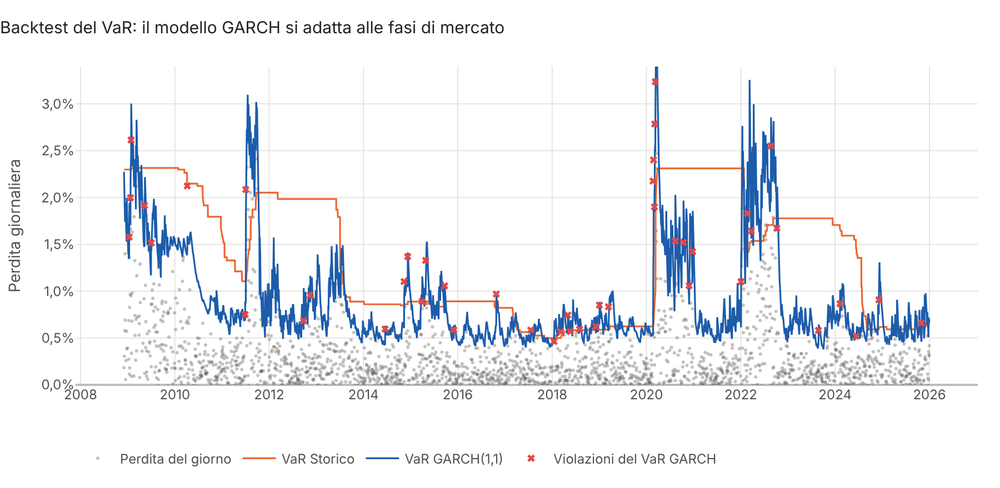
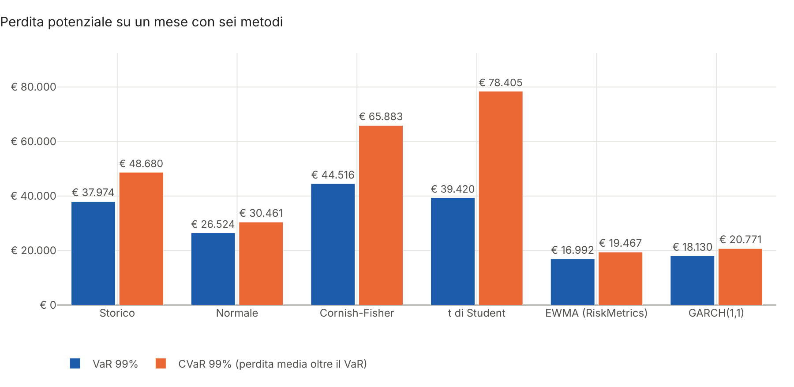
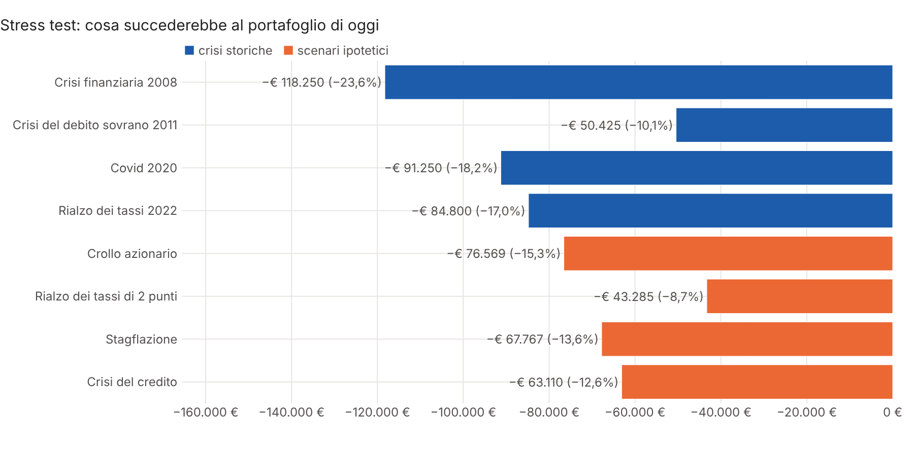
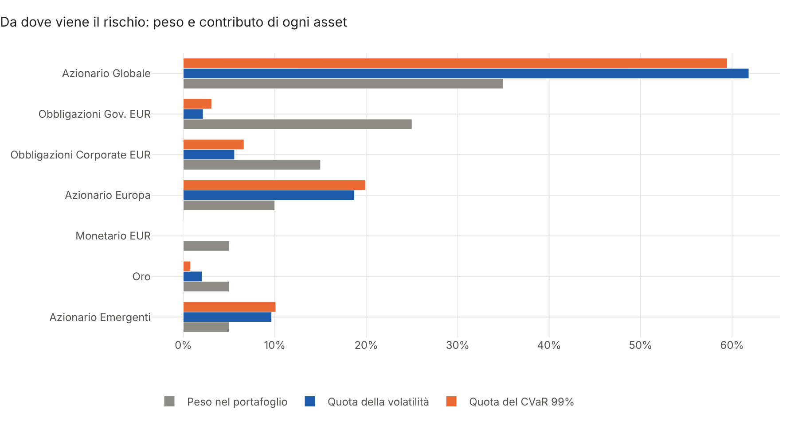
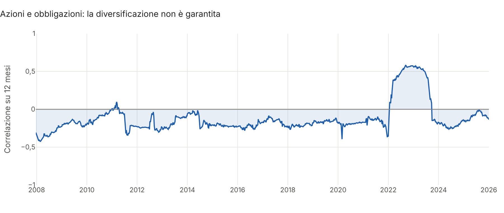
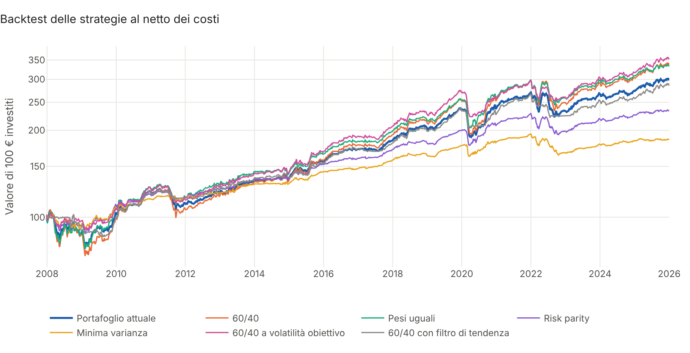
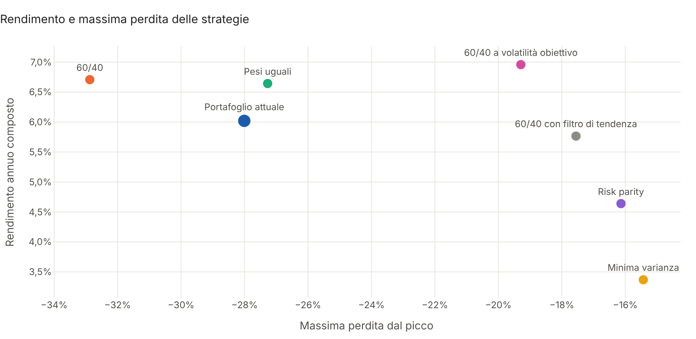

# Portfolio Risk Backtest

**Analisi del rischio di portafoglio e backtest delle strategie, in Python.**

Dato un portafoglio e la storia dei prezzi dei suoi strumenti, il progetto risponde alle domande che un cliente
fa davvero sul rischio: **quanto posso perdere in un mese cattivo? E in una crisi come quella del 2008 o del
2022? Il modello di rischio è affidabile o sottostima le perdite? Una strategia diversa avrebbe protetto meglio
il patrimonio?** Il risultato è un **report HTML interattivo pronto da consegnare al cliente**.



## Cosa fa

| Area | Contenuto |
|---|---|
| **VaR e CVaR** | Sei metodi a confronto: storico, normale, Cornish-Fisher, t di Student, EWMA (RiskMetrics), GARCH(1,1); orizzonte e livello di confidenza a scelta, importi in euro |
| **Volatilità condizionata** | EWMA con λ = 0,94 e GARCH(1,1) stimato per massima verosimiglianza, per misurare il rischio *di oggi* e non solo quello medio |
| **Backtest del VaR** | Previsioni giorno per giorno con i soli dati disponibili il giorno prima, test di copertura di **Kupiec**, test di indipendenza di **Christoffersen**, **semaforo di Basilea** sulle ultime 250 sedute |
| **Stress test** | Crisi storiche rivissute con il portafoglio di oggi (2008, debito sovrano 2011, Covid, rialzo dei tassi 2022) e scenari ipotetici con propagazione degli shock per regressione |
| **Scomposizione del rischio** | Contributo di ogni asset alla volatilità e al CVaR (scomposizione di Eulero), correlazione mobile azioni-obbligazioni |
| **Strategie** | Portafoglio del cliente contro 60/40, pesi uguali, **risk parity** (ERC), minima varianza, 60/40 a volatilità obiettivo, 60/40 con filtro di tendenza a 200 giorni |
| **Metriche** | Rendimento composto, volatilità, Sharpe, Sortino, Calmar, massima perdita e durata, **Probabilistic Sharpe Ratio**, alfa e beta con errori di Newey-West, rendimenti per anno |
| **Report** | HTML in italiano con 9 grafici interattivi Plotly, tabelle e un esito in linguaggio semplice |

Calcoli con `numpy`, `pandas` e `scipy` (stime di massima verosimiglianza, ottimizzazioni, test statistici),
regressioni con `statsmodels`, grafici `plotly`. Il backtest è **senza informazioni future**: ogni decisione
presa alla chiusura di un giorno si applica dal giorno dopo, e un test lo verifica.

## Avvio rapido

```bash
git clone https://github.com/Torraf-MI/portfolio-risk-backtest.git
cd portfolio-risk-backtest
pip install -e ".[png]"

# Report sull'esempio dimostrativo (portafoglio bilanciato da 500.000 €)
risk-backtest --demo --cliente "Famiglia Bianchi" --importo 500000

# Da un CSV di prezzi, con i propri pesi e un VaR al 95% su 10 giorni
risk-backtest --csv data/prezzi_esempio.csv --pesi "Globale=0.6, Gov=0.3, Oro=0.1" --livello 0.95 --orizzonte 10

# Con prezzi reali da Yahoo Finance (pip install -e ".[yahoo]")
risk-backtest --ticker VWCE.DE XGLE.DE SGLD.MI XEON.DE --pesi "VWCE=0.6, XGLE=0.25, SGLD=0.1, XEON=0.05"
```

Il report viene salvato in `output/report.html` (con `--offline` funziona anche senza connessione, con
`--grafici cartella` salva anche i PNG). Un esempio già generato: [`docs/report_esempio.html`](docs/report_esempio.html).

Il CSV ha una colonna di date e una colonna di prezzi per ogni strumento: è lo stesso formato di
[portfolio-optimizer](https://github.com/Torraf-MI/portfolio-optimizer) e dei prezzi esportati da
[wealth-dashboard](https://github.com/Torraf-MI/wealth-dashboard). La classe di ogni strumento (azioni,
governativi, corporate, oro, liquidità), che serve a 60/40, stress test e filtro di tendenza, è riconosciuta dal
nome o dai ticker più comuni.

## Uso come libreria

```python
from risk_backtest import (confronta, generate_sample_prices, normalizza_pesi, previsioni_var, rendimenti,
                           rendimenti_portafoglio, riepilogo, strategie_standard, stress_test, tabella_var)
from risk_backtest.dati import PESI_ESEMPIO

prezzi = generate_sample_prices()               # oppure load_csv("prezzi.csv")
pesi = normalizza_pesi(PESI_ESEMPIO, list(prezzi.columns))
rp = rendimenti_portafoglio(rendimenti(prezzi), pesi)

print(tabella_var(rp, livello=0.99, orizzonte=21) * 500_000)   # VaR e CVaR a un mese in euro
print(riepilogo(rp, previsioni_var(rp, 0.99), 0.99))           # violazioni, Kupiec, Christoffersen, semaforo
print([(e.nome, round(e.rendimento, 3)) for e in stress_test(prezzi, pesi)])

risultati = confronta(prezzi, strategie_standard(pesi), costi_bps=10)
```

Ogni strategia è una funzione che riceve i prezzi disponibili fino alla data di ribilanciamento e restituisce i
pesi, quindi se ne possono aggiungere di nuove in poche righe. Esempio completo in
[`examples/esempio.py`](examples/esempio.py).

## Risultati sull'esempio dimostrativo

Portafoglio bilanciato da 500.000 €: 50% azioni (globali, Europa, emergenti), 40% obbligazioni in euro (governative
e corporate), 5% oro, 5% monetario. Prezzi giornalieri dal 2007 al 2025.

| Indicatore | Valore |
|---|---|
| VaR 99% a un mese (storico) | € 37.974 |
| CVaR 99% a un mese (storico) | € 48.680 |
| VaR 99% a un mese con la curva normale | € 26.524, sottostimato di un terzo |
| VaR 99% a un mese con la volatilità di oggi (GARCH) | € 18.130 |
| Crisi più severa per il portafoglio di oggi | Crisi finanziaria 2008: −23,6%, −€ 118.250 |
| Massima perdita dal picco | −29,9% |

I rendimenti hanno code molto più pesanti della curva normale, che sottostima le perdite estreme. Il VaR va
quindi stimato con più metodi.



**I modelli reggono alla prova dei fatti?** Su 4.456 giornate di previsioni fuori campione al 99% ci si
aspettano circa 45 violazioni:

| Metodo | Violazioni | p-value Kupiec | p-value indipendenza | Esito |
|---|---|---|---|---|
| Storico | 54 | 0,169 | 0,000 | respinto: le violazioni arrivano a grappoli nelle crisi |
| Normale | 80 | 0,000 | 0,000 | respinto: sottostima il rischio |
| Cornish-Fisher | 43 | 0,813 | 0,072 | accettato |
| EWMA (RiskMetrics) | 54 | 0,169 | 0,250 | accettato |
| **GARCH(1,1)** | **46** | **0,829** | **0,327** | **accettato, il più accurato** |

Il VaR storico ha in media il numero giusto di violazioni ma si adatta in ritardo: resta basso all'inizio delle
crisi e troppo alto per anni dopo. I modelli a volatilità condizionata seguono le fasi di mercato.



Il 50% in azioni porta circa il 90% del rischio, sia come volatilità sia come CVaR, mentre il 25% in titoli di
Stato ne porta appena il 2-3%. Nel 2022 azioni e obbligazioni sono scese insieme e la diversificazione ha smesso di funzionare.





**Strategie a confronto** dal dicembre 2007 al 2025, con ribilanciamento mensile e 10 punti base di costi:

| Strategia | Rendimento annuo | Volatilità | Sharpe | Massima perdita | Rotazione annua |
|---|---|---|---|---|---|
| Portafoglio attuale | 6,0% | 8,0% | 0,58 | −28,0% | 27% |
| 60/40 | 6,7% | 9,9% | 0,56 | −32,9% | 28% |
| Pesi uguali | 6,6% | 8,9% | 0,60 | −27,3% | 30% |
| Risk parity | 4,6% | 5,7% | 0,56 | −16,1% | 40% |
| Minima varianza | 3,4% | 4,8% | 0,40 | −15,4% | 49% |
| 60/40 a volatilità obiettivo | 7,0% | 6,6% | 0,83 | −19,3% | 83% |
| 60/40 con filtro di tendenza | 5,8% | 6,3% | 0,68 | −17,6% | 274% |



Ridurre l'esposizione quando la volatilità sale ha portato la massima perdita del 60/40 da −32,9% a −19,3% senza
ridurne il rendimento. È l'unica strategia con un alfa significativo rispetto al 60/40 (2,1% annuo, p-value 0,005). Il
risultato dipende però dal fatto che nei dati dimostrativi la volatilità è persistente, come nei mercati reali,
e va verificato sui prezzi effettivi degli strumenti del cliente.



## Metodologia in breve

- **VaR storico e CVaR**: quantile empirico delle perdite e media delle perdite oltre il quantile.
- **Normale e Cornish-Fisher**: quantile normale, corretto con l'espansione di Cornish-Fisher per asimmetria e
  curtosi; il CVaR di Cornish-Fisher è l'integrale numerico dei quantili oltre il livello (`scipy.integrate`).
- **t di Student**: stima per massima verosimiglianza di gradi di libertà, posizione e scala; CVaR in forma chiusa.
- **EWMA**: σ²ₜ = λσ²ₜ₋₁ + (1−λ)r²ₜ con λ = 0,94, calcolata come filtro ricorsivo (`scipy.signal.lfilter`).
- **GARCH(1,1)**: σ²ₜ = ω + αε²ₜ₋₁ + βσ²ₜ₋₁, log-verosimiglianza gaussiana massimizzata con `scipy.optimize` sotto
  i vincoli di stazionarietà; nel backtest è ristimato ogni 250 giorni sui 500 precedenti.
- **Orizzonte**: regola della radice del tempo.
- **Test di Kupiec**: rapporto di verosimiglianza tra la frequenza di violazioni osservata e quella teorica.
  **Test di Christoffersen**: confronta la probabilità di una violazione dopo un giorno con e senza violazione.
  **Semaforo di Basilea**: verde finché la probabilità binomiale cumulata resta sotto il 95%, rosso oltre il 99,99%.
- **Stress storici**: rendimenti effettivi di ogni asset nella finestra della crisi, applicati ai pesi di oggi
  senza ribilanciamento, con la massima perdita dal picco durante la crisi.
- **Stress ipotetici**: shock istantanei sulle classi indicate; per gli altri asset rendimento condizionato
  stimato con una regressione OLS dei rendimenti mensili sugli asset colpiti (`statsmodels`).
- **Contributi al rischio**: wᵢ(Σw)ᵢ/σ per la volatilità; perdita media dell'asset nei giorni di coda del
  portafoglio per il CVaR. Entrambi sommano al totale.
- **Risk parity**: problema convesso di Spinu, min ½wᵀΣw − (1/n)Σ log wᵢ (`L-BFGS-B`), su una covarianza a un anno
  con shrinkage verso la diagonale. **Minima varianza**: `SLSQP` con tetto del 40% per asset.
- **Volatilità obiettivo**: esposizione = min(1, 8% / volatilità prevista EWMA), il resto in monetario.
  **Filtro di tendenza**: un asset resta in portafoglio solo se il prezzo è sopra la media a 200 giorni.
- **Backtest**: pesi che derivano con i prezzi tra un ribilanciamento e l'altro, costi in punti base sul
  controvalore scambiato. **Probabilistic Sharpe Ratio** di Bailey e López de Prado; alfa e beta da regressione
  dei rendimenti mensili in eccesso con errori HAC di Newey-West.
- **Dati dimostrativi**: moto browniano geometrico correlato con volatilità stocastica persistente e crisi con
  date e ordini di grandezza simili a quelle reali, calibrato in modo che ogni asset abbia il rendimento e la
  volatilità di lungo periodo indicati.

## Parte di una serie

| Progetto | Domanda a cui risponde |
|---|---|
| [portfolio-optimizer](https://github.com/Torraf-MI/portfolio-optimizer) | Qual è l'allocazione efficiente? (Markowitz, risk parity, backtest) |
| [real-estate-analyzer](https://github.com/Torraf-MI/real-estate-analyzer) | Conviene questo investimento immobiliare? (flussi, mutuo, fiscalità, TIR) |
| [wealth-planner-montecarlo](https://github.com/Torraf-MI/wealth-planner-montecarlo) | Il patrimonio basta per gli obiettivi e la pensione? (Monte Carlo) |
| [wealth-dashboard](https://github.com/Torraf-MI/wealth-dashboard) | Com'è il patrimonio oggi e cosa va fatto? (monitoraggio e ribilanciamento) |
| **portfolio-risk-backtest** | Quanto posso perdere e la strategia regge alle crisi? (VaR, stress test, backtest) |

## Struttura

```
src/risk_backtest/
├── dati.py        # prezzi da CSV o Yahoo Finance, dati dimostrativi con crisi, classi di attività, pesi
├── rischio.py     # VaR e CVaR con sei metodi, EWMA, GARCH(1,1), contributi al rischio
├── convalida.py   # previsioni fuori campione, test di Kupiec e Christoffersen, semaforo di Basilea
├── stress.py      # crisi storiche, scenari ipotetici con regressione, mesi peggiori
├── strategie.py   # 60/40, pesi uguali, risk parity, minima varianza, volatilità obiettivo, filtro di tendenza
├── backtest.py    # motore di backtest con deriva dei pesi e costi
├── metriche.py    # Sharpe, Sortino, Calmar, drawdown, Probabilistic Sharpe Ratio, alfa e beta
├── report.py      # grafici Plotly e report HTML
├── cli.py         # riga di comando
└── templates/     # modello del report
data/              # prezzi dimostrativi in CSV
examples/          # uso come libreria
tests/             # 33 test (pytest), eseguiti a ogni push con GitHub Actions
```

## Test

```bash
pip install -e ".[dev]"
pytest
```

I test verificano i calcoli su casi noti: VaR e CVaR storici su una serie costruita, formule chiuse della normale,
Cornish-Fisher che torna alla normale senza asimmetria e curtosi, ricorsione EWMA. Il GARCH e la t di Student
recuperano i parametri di serie simulate, i contributi al rischio sommano al totale. I test di Kupiec e
Christoffersen accettano le violazioni regolari e respingono quelle a grappoli, e il semaforo rispetta le soglie
di Basilea. Altri test controllano che le previsioni non usino dati futuri, che lo stress storico coincida con il
calcolo a mano e che la regressione propaghi correttamente uno shock. Sulle strategie: la risk parity eguaglia i
contributi, la minima varianza ha meno rischio dei pesi uguali, la volatilità obiettivo non usa leva, il motore di
backtest coincide con un calcolo manuale e i costi riducono il rendimento. Infine report e riga di comando si
generano senza errori.

## Avvertenze

I dati dell'esempio sono **simulati**: le crisi ricalcano per date e ordine di grandezza episodi reali, ma i
numeri non sono quelli storici di alcun indice o strumento. VaR e CVaR misurano il rischio con le condizioni del
passato e non sono un limite alla perdita possibile. L'espansione di Cornish-Fisher perde validità con
curtosi molto elevate. I backtest non considerano imposte né la liquidità degli strumenti, e risultati passati o
simulati non garantiscono quelli futuri. Il progetto ha scopo dimostrativo e non costituisce consulenza
finanziaria.

## Licenza

MIT. Autore: Francesco Torraco.
